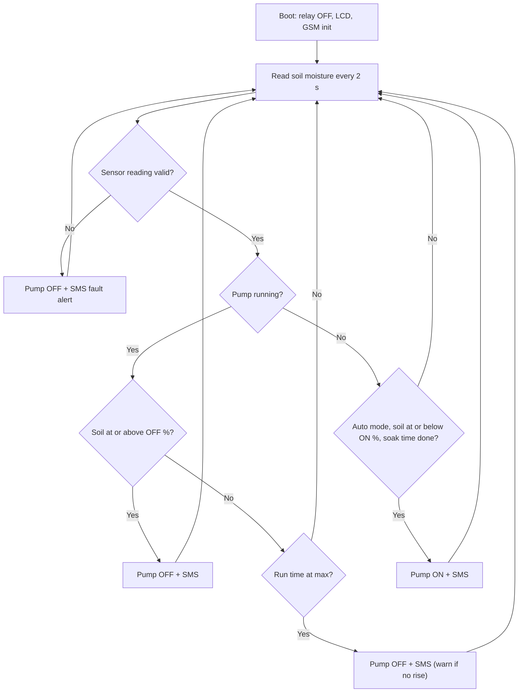

# Smart-Garden-Soil-Watering-Orchestrator
#piyushbopche
<svg xmlns="http://www.w3.org/2000/svg" viewBox="0 0 1000 620" width="1000" height="620" font-family="Segoe UI, Arial, Helvetica, sans-serif" xmlns:c2pa="http://c2pa.org/manifest"><metadata><c2pa:manifest>AAAWgmp1bWIAAAAeanVtZGMycGEAEQAQgAAAqgA4m3EDYzJwYQAAABZcanVtYgAAAEdqdW1kYzJtYQARABCAAACqADibcQN1cm46YzJwYTpkZDAwODEwZi03YWJhLTRiNGEtYjg1NC01YWM1OGJmMjc3NTgAAAADl2p1bWIAAAApanVtZGMyYXMAEQAQgAAAqgA4m3EDYzJwYS5hc3NlcnRpb25zAAAAALxqdW1iAAAARGp1bWRjYm9yABEAEIAAAKoAOJtxE2MycGEuaW5ncmVkaWVudC52MwAAAAAYYzJzaM1GHFB04nNW0Eld8uiQIdMAAABwY2JvcqNpZGM6Zm9ybWF0bWltYWdlL3N2Zyt4bWxqaW5zdGFuY2VJRHgseG1wOmlpZDo3ODk3Yzg3Yi1jNWI2LTQ4YjctYmY5Zi0xMjAzNjU5YTFjZThscmVsYXRpb25zaGlwaHBhcmVudE9mAAAB4mp1bWIAAABBanVtZGNib3IAEQAQgAAAqgA4m3ETYzJwYS5hY3Rpb25zLnYyAAAAABhjMnNo1jVEjbZBmI6wYTwgABu8tgAAAZljYm9yomdhY3Rpb25zgqJmYWN0aW9ua2MycGEub3BlbmVkanBhcmFtZXRlcnOha2luZ3JlZGllbnRzgaJjdXJseC1zZWxmI2p1bWJmPWMycGEuYXNzZXJ0aW9ucy9jMnBhLmluZ3JlZGllbnQudjNkaGFzaFggwre4CYXthXF6b/5DAJvhjha4P7bj+cldUiuwpEUS6+6kZmFjdGlvbngdY29tLmFudGhyb3BpYy5jbGF1ZGUucHJvdmlkZWRqcGFyYW1ldGVyc6F4H2NvbS5hbnRocm9waWMub3JpZ2luLWNvbmZpZGVuY2VndW5rbm93bmtkZXNjcmlwdGlvbnhmQ2xhdWRlIHByb3ZpZGVkIHRoaXMgZmlsZSBhdCB0aGUgcmVxdWVzdCBvZiBhIHVzZXIgYW5kIG1heSBoYXZlIGNyZWF0ZWQgb3IgbW9kaWZpZWQgdGhlIGZpbGUgY29udGVudHMubXNvZnR3YXJlQWdlbnShZG5hbWVmQ2xhdWRlcmFsbEFjdGlvbnNJbmNsdWRlZPUAAADIanVtYgAAAEBqdW1kY2JvcgARABCAAACqADibcRNjMnBhLmhhc2guZGF0YQAAAAAYYzJzaG7y2jLgnt9HofZKOiVgO0EAAACAY2JvcqVjYWxnZnNoYTI1NmNwYWRNAAAAAAAAAAAAAAAAAGRoYXNoWCCXa50EnoZjVHyPKoKBAXi6Jwn2pf08bm99JRrC+qWeg2RuYW1lbmp1bWJmIG1hbmlmZXN0amV4Y2x1c2lvbnOBomVzdGFydBjNZmxlbmd0aBkeBAAAAj5qdW1iAAAAJ2p1bWRjMmNsABEAEIAAAKoAOJtxA2MycGEuY2xhaW0udjIAAAACD2Nib3KlY2FsZ2ZzaGEyNTZpc2lnbmF0dXJleE1zZWxmI2p1bWJmPS9jMnBhL3VybjpjMnBhOmRkMDA4MTBmLTdhYmEtNGI0YS1iODU0LTVhYzU4YmYyNzc1OC9jMnBhLnNpZ25hdHVyZWppbnN0YW5jZUlEeCx4bXA6aWlkOjgxNzRkZTc1LTY2OTUtNDU2OC04ZDU4LWVjNTllMDdiZDgyMnJjcmVhdGVkX2Fzc2VydGlvbnODomN1cmx4LXNlbGYjanVtYmY9YzJwYS5hc3NlcnRpb25zL2MycGEuaW5ncmVkaWVudC52M2RoYXNoWCDCt7gJhe2FcXpv/kMAm+GOFrg/tuP5yV1SK7CkRRLr7qJjdXJseCpzZWxmI2p1bWJmPWMycGEuYXNzZXJ0aW9ucy9jMnBhLmFjdGlvbnMudjJkaGFzaFggoxQHLZAHNuNXddaIPv/ERxxVBn/Xiqy2xbK1QYhj3uSiY3VybHgpc2VsZiNqdW1iZj1jMnBhLmFzc2VydGlvbnMvYzJwYS5oYXNoLmRhdGFkaGFzaFggTbUWAX2J8sYiQD8xZ3M51yOsIYvGvHhwQoujcqQUBEF0Y2xhaW1fZ2VuZXJhdG9yX2luZm+jZG5hbWVvQW50aHJvcGljIEZpbGVzZ3ZlcnNpb25lMS4wLjBrc3BlY1ZlcnNpb25lMi40LjAAABA4anVtYgAAAChqdW1kYzJjcwARABCAAACqADibcQNjMnBhLnNpZ25hdHVyZQAAABAIY2JvctKEWQISogEmGCFZAgowggIGMIIBjaADAgECAhRA5aAK7sI50L64g/oGQgU9Z1UTADAKBggqhkjOPQQDAzBJMRcwFQYDVQQKEw5BbnRocm9waWMsIFBCQzEuMCwGA1UEAxMlQW50aHJvcGljIENvbnRlbnQgQ3JlZGVudGlhbHMgUm9vdCBDQTAeFw0yNjA4MDcxODQzNTZaFw0yODA4MDYxOTQzNTZaMEQxFzAVBgNVBAoTDkFudGhyb3BpYywgUEJDMSkwJwYDVQQDEyBBbnRocm9waWMgQ2xhdWRlIENvbnRlbnQgU2lnbmluZzBZMBMGByqGSM49AgEGCCqGSM49AwEHA0IABJh6CmvLUBgFFNU0vUKlOVtE6djd17L5SuwX0LemFisBM3dkd/3cyjxFA3Qo5S46fX0/ihY0VZ7mfb9KF703t5OjWDBWMA4GA1UdDwEB/wQEAwIHgDAVBgNVHSUEDjAMBgorBgEEAYPoXgIBMAwGA1UdEwEB/wQCMAAwHwYDVR0jBBgwFoAUzlHiBIFOZFsj+OPEz5o+nMHXXMIwCgYIKoZIzj0EAwMDZwAwZAIwMXMdFJ4BetLLVY7ORuE9noqbbAZOZn/aArXyTwFAZfKrPzxF2vPoJNf1+UCdg1XGAjBwX1zd9WGqYkqmL5SFqw1QySjr1zJfpJM9+1rdDwSPLMOPOjKuiXjoU/pUUeG9RwmhY3BhZFkNngAAAAAAAAAAAAAAAAAAAAAAAAAAAAAAAAAAAAAAAAAAAAAAAAAAAAAAAAAAAAAAAAAAAAAAAAAAAAAAAAAAAAAAAAAAAAAAAAAAAAAAAAAAAAAAAAAAAAAAAAAAAAAAAAAAAAAAAAAAAAAAAAAAAAAAAAAAAAAAAAAAAAAAAAAAAAAAAAAAAAAAAAAAAAAAAAAAAAAAAAAAAAAAAAAAAAAAAAAAAAAAAAAAAAAAAAAAAAAAAAAAAAAAAAAAAAAAAAAAAAAAAAAAAAAAAAAAAAAAAAAAAAAAAAAAAAAAAAAAAAAAAAAAAAAAAAAAAAAAAAAAAAAAAAAAAAAAAAAAAAAAAAAAAAAAAAAAAAAAAAAAAAAAAAAAAAAAAAAAAAAAAAAAAAAAAAAAAAAAAAAAAAAAAAAAAAAAAAAAAAAAAAAAAAAAAAAAAAAAAAAAAAAAAAAAAAAAAAAAAAAAAAAAAAAAAAAAAAAAAAAAAAAAAAAAAAAAAAAAAAAAAAAAAAAAAAAAAAAAAAAAAAAAAAAAAAAAAAAAAAAAAAAAAAAAAAAAAAAAAAAAAAAAAAAAAAAAAAAAAAAAAAAAAAAAAAAAAAAAAAAAAAAAAAAAAAAAAAAAAAAAAAAAAAAAAAAAAAAAAAAAAAAAAAAAAAAAAAAAAAAAAAAAAAAAAAAAAAAAAAAAAAAAAAAAAAAAAAAAAAAAAAAAAAAAAAAAAAAAAAAAAAAAAAAAAAAAAAAAAAAAAAAAAAAAAAAAAAAAAAAAAAAAAAAAAAAAAAAAAAAAAAAAAAAAAAAAAAAAAAAAAAAAAAAAAAAAAAAAAAAAAAAAAAAAAAAAAAAAAAAAAAAAAAAAAAAAAAAAAAAAAAAAAAAAAAAAAAAAAAAAAAAAAAAAAAAAAAAAAAAAAAAAAAAAAAAAAAAAAAAAAAAAAAAAAAAAAAAAAAAAAAAAAAAAAAAAAAAAAAAAAAAAAAAAAAAAAAAAAAAAAAAAAAAAAAAAAAAAAAAAAAAAAAAAAAAAAAAAAAAAAAAAAAAAAAAAAAAAAAAAAAAAAAAAAAAAAAAAAAAAAAAAAAAAAAAAAAAAAAAAAAAAAAAAAAAAAAAAAAAAAAAAAAAAAAAAAAAAAAAAAAAAAAAAAAAAAAAAAAAAAAAAAAAAAAAAAAAAAAAAAAAAAAAAAAAAAAAAAAAAAAAAAAAAAAAAAAAAAAAAAAAAAAAAAAAAAAAAAAAAAAAAAAAAAAAAAAAAAAAAAAAAAAAAAAAAAAAAAAAAAAAAAAAAAAAAAAAAAAAAAAAAAAAAAAAAAAAAAAAAAAAAAAAAAAAAAAAAAAAAAAAAAAAAAAAAAAAAAAAAAAAAAAAAAAAAAAAAAAAAAAAAAAAAAAAAAAAAAAAAAAAAAAAAAAAAAAAAAAAAAAAAAAAAAAAAAAAAAAAAAAAAAAAAAAAAAAAAAAAAAAAAAAAAAAAAAAAAAAAAAAAAAAAAAAAAAAAAAAAAAAAAAAAAAAAAAAAAAAAAAAAAAAAAAAAAAAAAAAAAAAAAAAAAAAAAAAAAAAAAAAAAAAAAAAAAAAAAAAAAAAAAAAAAAAAAAAAAAAAAAAAAAAAAAAAAAAAAAAAAAAAAAAAAAAAAAAAAAAAAAAAAAAAAAAAAAAAAAAAAAAAAAAAAAAAAAAAAAAAAAAAAAAAAAAAAAAAAAAAAAAAAAAAAAAAAAAAAAAAAAAAAAAAAAAAAAAAAAAAAAAAAAAAAAAAAAAAAAAAAAAAAAAAAAAAAAAAAAAAAAAAAAAAAAAAAAAAAAAAAAAAAAAAAAAAAAAAAAAAAAAAAAAAAAAAAAAAAAAAAAAAAAAAAAAAAAAAAAAAAAAAAAAAAAAAAAAAAAAAAAAAAAAAAAAAAAAAAAAAAAAAAAAAAAAAAAAAAAAAAAAAAAAAAAAAAAAAAAAAAAAAAAAAAAAAAAAAAAAAAAAAAAAAAAAAAAAAAAAAAAAAAAAAAAAAAAAAAAAAAAAAAAAAAAAAAAAAAAAAAAAAAAAAAAAAAAAAAAAAAAAAAAAAAAAAAAAAAAAAAAAAAAAAAAAAAAAAAAAAAAAAAAAAAAAAAAAAAAAAAAAAAAAAAAAAAAAAAAAAAAAAAAAAAAAAAAAAAAAAAAAAAAAAAAAAAAAAAAAAAAAAAAAAAAAAAAAAAAAAAAAAAAAAAAAAAAAAAAAAAAAAAAAAAAAAAAAAAAAAAAAAAAAAAAAAAAAAAAAAAAAAAAAAAAAAAAAAAAAAAAAAAAAAAAAAAAAAAAAAAAAAAAAAAAAAAAAAAAAAAAAAAAAAAAAAAAAAAAAAAAAAAAAAAAAAAAAAAAAAAAAAAAAAAAAAAAAAAAAAAAAAAAAAAAAAAAAAAAAAAAAAAAAAAAAAAAAAAAAAAAAAAAAAAAAAAAAAAAAAAAAAAAAAAAAAAAAAAAAAAAAAAAAAAAAAAAAAAAAAAAAAAAAAAAAAAAAAAAAAAAAAAAAAAAAAAAAAAAAAAAAAAAAAAAAAAAAAAAAAAAAAAAAAAAAAAAAAAAAAAAAAAAAAAAAAAAAAAAAAAAAAAAAAAAAAAAAAAAAAAAAAAAAAAAAAAAAAAAAAAAAAAAAAAAAAAAAAAAAAAAAAAAAAAAAAAAAAAAAAAAAAAAAAAAAAAAAAAAAAAAAAAAAAAAAAAAAAAAAAAAAAAAAAAAAAAAAAAAAAAAAAAAAAAAAAAAAAAAAAAAAAAAAAAAAAAAAAAAAAAAAAAAAAAAAAAAAAAAAAAAAAAAAAAAAAAAAAAAAAAAAAAAAAAAAAAAAAAAAAAAAAAAAAAAAAAAAAAAAAAAAAAAAAAAAAAAAAAAAAAAAAAAAAAAAAAAAAAAAAAAAAAAAAAAAAAAAAAAAAAAAAAAAAAAAAAAAAAAAAAAAAAAAAAAAAAAAAAAAAAAAAAAAAAAAAAAAAAAAAAAAAAAAAAAAAAAAAAAAAAAAAAAAAAAAAAAAAAAAAAAAAAAAAAAAAAAAAAAAAAAAAAAAAAAAAAAAAAAAAAAAAAAAAAAAAAAAAAAAAAAAAAAAAAAAAAAAAAAAAAAAAAAAAAAAAAAAAAAAAAAAAAAAAAAAAAAAAAAAAAAAAAAAAAAAAAAAAAAAAAAAAAAAAAAAAAAAAAAAAAAAAAAAAAAAAAAAAAAAAAAAAAAAAAAAAAAAAAAAAAAAAAAAAAAAAAAAAAAAAAAAAAAAAAAAAAAAAAAAAAAAAAAAAAAAAAAAAAAAAAAAAAAAAAAAAAAAAAAAAAAAAAAAAAAAAAAAAAAAAAAAAAAAAAAAAAAAAAAAAAAAAAAAAAAAAAAAAAAAAAAAAAAAAAAAAAAAAAAAAAAAAAAAAAAAAAAAAAAAAAAAAAAAAAAAAAAAAAAAAAAAAAAAAAAAAAAAAAAAAAAAAAAAAAAAAAAAAAAAAAAAAAAAAAAAAAAAAAAAAAAAAAAAAAAAAAAAAAAAAAAAAAAAAAAAAAAAAAAAAAAAAAAAAAAAAAAAAAAAAAAAAAAAAAAAAAAAAAAAAAAAAAAAAAAAAAAAAAAAAAAAAAAAAAAAAAAAAAAAAAAAAAAAAAAAAAAAAAAAAAAAAAAAAAAAAAAAAAAAAAAAAAAAAAAAAAAAAAAAAAAAAAAAAAAAAAAAAAAAAAAAAAAAAAAAAAAAAAAAAAAAAAAAAAAAAAAAAAAAAAAAAAAAAAAAAAAAAAAAAAAAAAAAAAAAAAAAAAAAAAAAAAAAAAAAAAAAAAAAAAAAAAAAAAAAAAAAAAAAAAAAAAAAAAAAAAAAAAAAAAAAAAAAAAAAAAAAAAAAAAAAAAAAAAAAAAAAAAAAAAAAAAAAAAAAAAAAAAAAAAAAAAAAAAAAAAAAAAAAAAAAAAAAAAAAAAAAAAAAAAAAAAAAAAAAAAAAAAAAAAAAAAAAAAAAAAAAAAAAAAAAAAAAAAAAAAAAAAAAAAAAAAAAAAAAAAAAAAAAAAAAAAAAAAAAAAAAAAAAAAAAAAAAAAAAAAAAAAAAAAAAAAAAAAAAAAAAAAAAAAAAAAAAAAAAAAAAAAAAAAAAAAAAAAAAAAAAAAAAAAAAAAAAAAAAAAAAAAAAAAAAAAAAAAAAAAAAAAAAAAAAAAAAAAAAAAAAAAAAAAAAAAAAAAAAAAAAAAAAAAAAAAAAAAAAAAAAAAAAAAAAAAAAAAAAAAAAAAAAAAAAAAAAAAAAAAAAAAAAAAAAAAAAAAAAAAAAAAAAAAAAAAAAAAAAAAAAAAAAAAAAAAAAAAAAAAAAAAAAAAAAAAAAAAAAAAAAAAAAAAAAAAAAAAAAAAAAAAAAAAAAAAAAAAAAAAAAAAAAAAAAAAAAAAAAAAAAAAAAAAAAAAAAAAAAAAAAAAAAAAAAAAAAAAAAAAAAAAAAAAAAAAAAAAAAAAAAAAAAAAAAAAAAAAAAAAAAAAAAAAAAAAAAAAAAAAAAAAAAAAAAAAAAAAAAAAAAAAAAAAAAAAAAAAAAAAAAAAAAAAAAAAAAAAAAAAAAAAAAAAAAAAAAAAAAAAAAAAAAAAAAAAAAAAAAAAAAAAAAAAAAAAAAAAAAAAAAAAAAAAAAAAAAAAAAAAAAAAAAAAAAAAAAAAAAAAAAAAAAAAAAAAAAAAAAAAAAAAAAAAAAAAAAAAAAAAAAAAAAAAAAAAAAAAAAAAAAAAAAAAAAAAAPZYQOJczXh2lDTmabKfXct5lEwH3763NQ2/GqugzM3rKbTBS3ev8kkETfZW0LxeVuO4GeCA81Dpa7DLrSZcIA0F+sE=</c2pa:manifest></metadata>
  <defs>
    <marker id="a" viewBox="0 0 10 10" refX="9" refY="5" markerWidth="7" markerHeight="7" orient="auto">
      <path d="M0,0 L10,5 L0,10 z" fill="#455A64"/>
    </marker>
  </defs>
  <rect width="1000" height="620" fill="#ffffff"/>

  <text x="20" y="40" font-size="20" font-weight="bold" fill="#263238">Control loop</text>
  <text x="20" y="62" font-size="13" fill="#607D8B">Smart Garden Soil &amp; Watering Orchestrator</text>

  <!-- ===== main column ===== -->
  <rect x="470" y="20" width="300" height="44" rx="22" fill="#37474F"/>
  <text x="620" y="47" text-anchor="middle" font-size="13" fill="#ffffff">Boot: relay OFF · LCD · GSM init</text>
  <line x1="620" y1="64" x2="620" y2="100" stroke="#455A64" stroke-width="2" marker-end="url(#a)"/>

  <rect x="470" y="100" width="300" height="44" rx="8" fill="#E8F1FB" stroke="#2F6DB5" stroke-width="2"/>
  <text x="620" y="119" text-anchor="middle" font-size="13" font-weight="bold" fill="#1A3C66">Read soil moisture</text>
  <text x="620" y="135" text-anchor="middle" font-size="12" fill="#455A64">every 2 s · 10-sample average</text>
  <line x1="620" y1="144" x2="620" y2="175" stroke="#455A64" stroke-width="2" marker-end="url(#a)"/>

  <!-- sensor valid -->
  <polygon points="620,175 730,215 620,255 510,215" fill="#FFF6DB" stroke="#B8860B" stroke-width="2"/>
  <text x="620" y="211" text-anchor="middle" font-size="13" fill="#3E2F00">Sensor</text>
  <text x="620" y="227" text-anchor="middle" font-size="13" fill="#3E2F00">reading valid?</text>
  <line x1="730" y1="215" x2="790" y2="215" stroke="#455A64" stroke-width="2" marker-end="url(#a)"/>
  <text x="752" y="207" text-anchor="middle" font-size="12" fill="#455A64">No</text>
  <rect x="790" y="190" width="180" height="50" rx="8" fill="#FDE8E8" stroke="#C62828" stroke-width="2"/>
  <text x="880" y="211" text-anchor="middle" font-size="13" font-weight="bold" fill="#7F1D1D">Pump OFF + SMS</text>
  <text x="880" y="228" text-anchor="middle" font-size="12" fill="#455A64">fault alert</text>
  <line x1="880" y1="240" x2="880" y2="250" stroke="#455A64" stroke-width="2"/>
  <circle cx="880" cy="262" r="12" fill="#ffffff" stroke="#455A64" stroke-width="2"/>
  <text x="880" y="266" text-anchor="middle" font-size="12" font-weight="bold" fill="#263238">A</text>

  <line x1="620" y1="255" x2="620" y2="290" stroke="#455A64" stroke-width="2" marker-end="url(#a)"/>
  <text x="632" y="277" font-size="12" fill="#455A64">Yes</text>

  <!-- pump running -->
  <polygon points="620,290 730,330 620,370 510,330" fill="#FFF6DB" stroke="#B8860B" stroke-width="2"/>
  <text x="620" y="335" text-anchor="middle" font-size="13" fill="#3E2F00">Pump running?</text>
  <line x1="510" y1="330" x2="430" y2="330" stroke="#455A64" stroke-width="2" marker-end="url(#a)"/>
  <text x="470" y="322" text-anchor="middle" font-size="12" fill="#455A64">Yes</text>
  <line x1="620" y1="370" x2="620" y2="415" stroke="#455A64" stroke-width="2" marker-end="url(#a)"/>
  <text x="632" y="396" font-size="12" fill="#455A64">No</text>

  <!-- not running: auto start -->
  <polygon points="620,415 750,460 620,505 490,460" fill="#FFF6DB" stroke="#B8860B" stroke-width="2"/>
  <text x="620" y="457" text-anchor="middle" font-size="12" fill="#3E2F00">Auto mode, soil ≤ ON %,</text>
  <text x="620" y="473" text-anchor="middle" font-size="12" fill="#3E2F00">soak time done?</text>
  <line x1="750" y1="460" x2="790" y2="460" stroke="#455A64" stroke-width="2" marker-end="url(#a)"/>
  <text x="770" y="452" text-anchor="middle" font-size="12" fill="#455A64">Yes</text>
  <rect x="790" y="435" width="180" height="50" rx="8" fill="#E3F5E6" stroke="#2E7D32" stroke-width="2"/>
  <text x="880" y="456" text-anchor="middle" font-size="13" font-weight="bold" fill="#1B5E20">Pump ON + SMS</text>
  <text x="880" y="473" text-anchor="middle" font-size="12" fill="#455A64">start watering</text>
  <line x1="880" y1="485" x2="880" y2="495" stroke="#455A64" stroke-width="2"/>
  <circle cx="880" cy="507" r="12" fill="#ffffff" stroke="#455A64" stroke-width="2"/>
  <text x="880" y="511" text-anchor="middle" font-size="12" font-weight="bold" fill="#263238">A</text>
  <line x1="620" y1="505" x2="620" y2="535" stroke="#455A64" stroke-width="2"/>
  <text x="632" y="526" font-size="12" fill="#455A64">No</text>
  <circle cx="620" cy="547" r="12" fill="#ffffff" stroke="#455A64" stroke-width="2"/>
  <text x="620" y="551" text-anchor="middle" font-size="12" font-weight="bold" fill="#263238">A</text>

  <!-- ===== running branch (left) ===== -->
  <polygon points="330,290 430,330 330,370 230,330" fill="#FFF6DB" stroke="#B8860B" stroke-width="2"/>
  <text x="330" y="335" text-anchor="middle" font-size="13" fill="#3E2F00">Soil ≥ OFF %?</text>
  <line x1="230" y1="330" x2="180" y2="330" stroke="#455A64" stroke-width="2" marker-end="url(#a)"/>
  <text x="205" y="322" text-anchor="middle" font-size="12" fill="#455A64">Yes</text>
  <rect x="20" y="305" width="160" height="50" rx="8" fill="#ECEFF1" stroke="#607D8B" stroke-width="2"/>
  <text x="100" y="326" text-anchor="middle" font-size="13" font-weight="bold" fill="#263238">Pump OFF + SMS</text>
  <text x="100" y="343" text-anchor="middle" font-size="12" fill="#455A64">soil wet enough</text>
  <line x1="100" y1="355" x2="100" y2="365" stroke="#455A64" stroke-width="2"/>
  <circle cx="100" cy="377" r="12" fill="#ffffff" stroke="#455A64" stroke-width="2"/>
  <text x="100" y="381" text-anchor="middle" font-size="12" font-weight="bold" fill="#263238">A</text>

  <line x1="330" y1="370" x2="330" y2="415" stroke="#455A64" stroke-width="2" marker-end="url(#a)"/>
  <text x="342" y="396" font-size="12" fill="#455A64">No</text>

  <polygon points="330,415 430,460 330,505 230,460" fill="#FFF6DB" stroke="#B8860B" stroke-width="2"/>
  <text x="330" y="465" text-anchor="middle" font-size="13" fill="#3E2F00">Run time ≥ max?</text>
  <line x1="230" y1="460" x2="180" y2="460" stroke="#455A64" stroke-width="2" marker-end="url(#a)"/>
  <text x="205" y="452" text-anchor="middle" font-size="12" fill="#455A64">Yes</text>
  <rect x="20" y="435" width="160" height="50" rx="8" fill="#FDE8E8" stroke="#C62828" stroke-width="2"/>
  <text x="100" y="456" text-anchor="middle" font-size="13" font-weight="bold" fill="#7F1D1D">Pump OFF + SMS</text>
  <text x="100" y="473" text-anchor="middle" font-size="12" fill="#455A64">warn if no rise</text>
  <line x1="100" y1="485" x2="100" y2="495" stroke="#455A64" stroke-width="2"/>
  <circle cx="100" cy="507" r="12" fill="#ffffff" stroke="#455A64" stroke-width="2"/>
  <text x="100" y="511" text-anchor="middle" font-size="12" font-weight="bold" fill="#263238">A</text>
  <line x1="330" y1="505" x2="330" y2="535" stroke="#455A64" stroke-width="2"/>
  <text x="342" y="526" font-size="12" fill="#455A64">No</text>
  <circle cx="330" cy="547" r="12" fill="#ffffff" stroke="#455A64" stroke-width="2"/>
  <text x="330" y="551" text-anchor="middle" font-size="12" font-weight="bold" fill="#263238">A</text>

  <!-- legend -->
  <line x1="20" y1="585" x2="980" y2="585" stroke="#CFD8DC" stroke-width="1.5"/>
  <circle cx="32" cy="604" r="10" fill="#ffffff" stroke="#455A64" stroke-width="2"/>
  <text x="32" y="608" text-anchor="middle" font-size="11" font-weight="bold" fill="#263238">A</text>
  <text x="52" y="608" font-size="13" fill="#37474F">= loop back to “Read soil moisture”. The max run time is also enforced while the GSM modem is busy.</text>
</svg>


# 🌱 Smart Garden Soil & Watering Orchestrator

An Arduino Mega 2560 irrigation controller that reads soil moisture, waters **only when the soil actually needs it**, and keeps you informed over **GSM SMS**, with no Wi-Fi or internet needed. You can also control it by text message from anywhere with mobile coverage.

---

## ✨ Features

- **Automatic irrigation**: pump turns ON below a dry threshold and OFF above a wet threshold (hysteresis, so the relay never chatters)
- **Reduces water wastage**: soak time between cycles lets water reach the sensor before the next decision
- **Pump safety**: hard maximum run time per cycle, even while the GSM modem is busy
- **Fault detection**: SMS alert if the sensor reads out of range; watering is disabled until it recovers
- **"Not rising" warning**: SMS if moisture barely improves after a full cycle (empty tank, blocked pipe, or bad sensor)
- **SMS control**: `STATUS`, `WATER`, `STOP`, `AUTO ON`, `AUTO OFF`, accepted from the owner number only
- **Live 20x4 I2C LCD**: moisture %, raw value, pump state, mode, GSM status
- **Serial debug output** at 9600 baud, useful for calibration

---

## 🧰 Hardware

| Part | Qty | Notes |
|------|-----|-------|
| Arduino Mega 2560 | 1 | Uses hardware `Serial1` for the modem |
| SIM800A GSM module | 1 | **2G only**, so use a SIM with 2G coverage |
| Capacitive soil moisture sensor (v1.2) | 1 | Analog output |
| 1-channel relay module (5 V) | 1 | Active-LOW by default |
| DC water pump / solenoid valve | 1 | Powered from its own supply |
| 20x4 LCD with I2C backpack | 1 | Address `0x27` (or `0x3F`) |
| External supply for GSM | 1 | Check your board's spec (typically 4-5 V, 2 A peak) |
| Flyback diode (1N4007) | 1 | Across a DC pump or valve coil |
| Jumper wires, enclosure, tubing | - | |

---

## 🔌 Wiring

```
                         +---------------------------+
 Soil sensor AOUT -----> | A0                        |
                         |                           |        +-------------+
                         |       ARDUINO MEGA 2560   |        |   SIM800A   |
                         |                     TX1 18| -----> | RX          |
                         |                     RX1 19| <----- | TX          |
                         |                           |        +-------------+
 Relay IN <------------- | D7                        |
 LCD SDA  <------------> | D20 (SDA)                 |
 LCD SCL  <------------- | D21 (SCL)                 |
                         +---------------------------+
```

| From | To (Mega 2560) |
|------|----------------|
| Soil sensor VCC / GND / AOUT | 5V / GND / A0 |
| Relay VCC / GND / IN | 5V / GND / D7 |
| LCD VCC / GND / SDA / SCL | 5V / GND / D20 / D21 |
| SIM800A TX | D19 (RX1) |
| SIM800A RX | D18 (TX1), via a level shifter or divider if your board is not 5 V tolerant |
| SIM800A GND | GND (**common ground with the Mega**) |
| Pump | Separate supply, wired through relay COM / NO |

> ⚠️ Power the SIM800A from its own supply that can deliver 2 A bursts. Powering it from the Mega's 5 V pin causes random resets and SMS failures.

<!-- Add your own photos:  -->

---

## 🧠 How it works



Moisture % is computed from the raw ADC value using two calibration points (dry air and water), averaged over 10 samples.

---

## 📲 SMS commands

Send these from the number set as `OWNER_NUMBER`. Messages from any other number are ignored.

| Command | Action |
|---------|--------|
| `STATUS` | Replies with moisture %, raw value, pump state and mode |
| `WATER` | Starts a manual cycle (refused if the soil is already wet or the sensor is faulty) |
| `STOP` | Stops the pump immediately |
| `AUTO ON` | Enables automatic watering |
| `AUTO OFF` | Disables automatic watering (manual `WATER` still works) |
| anything else | Replies with the command list |

Automatic SMS alerts: watering started, watering stopped (with reason and duration), sensor fault, and a startup message.

---

## 🚀 Getting started

1. **Install the library**: in the Arduino IDE open *Library Manager* and install **LiquidCrystal I2C** by Frank de Brabander.
2. **Open the sketch**: `SmartGarden_Orchestrator/SmartGarden_Orchestrator.ino`
3. **Set your number**: edit `OWNER_NUMBER` (with country code, e.g. `+91XXXXXXXXXX`).
4. **Select** *Tools → Board → Arduino Mega or Mega 2560*, choose the port, and upload.
5. **Calibrate** the sensor (below), then re-upload.
6. Insert an active 2G SIM (PIN lock disabled), power the modem, and reset the board. You should get an SMS saying *Smart Garden online*.

### Calibrating the sensor

1. Open the Serial Monitor at **9600 baud**. Each sample prints `raw=... soil=...%`.
2. Hold the sensor **in dry air** and note the raw value, then set `SENSOR_DRY_RAW`.
3. Dip it into a glass of water **up to the marked line** and note the raw value, then set `SENSOR_WET_RAW`.
4. Re-upload. Then tune `MOISTURE_ON_PCT` / `MOISTURE_OFF_PCT` for your plants and soil.

---

## ⚙️ Configuration

| Constant | Default | Meaning |
|----------|---------|---------|
| `OWNER_NUMBER` | `+91XXXXXXXXXX` | Number that receives alerts and may send commands |
| `SENSOR_DRY_RAW` / `SENSOR_WET_RAW` | 600 / 270 | Calibration points (raw ADC) |
| `RAW_FAULT_LOW` / `RAW_FAULT_HIGH` | 50 / 1000 | Raw values outside this range count as a sensor fault |
| `MOISTURE_ON_PCT` | 30 | Start watering at or below this |
| `MOISTURE_OFF_PCT` | 60 | Stop watering at or above this |
| `MIN_RISE_PCT` | 5 | Expected moisture gain per cycle, otherwise warn |
| `MAX_RUN_MS` | 60000 | Hard cap on pump time per cycle |
| `SOAK_MS` | 900000 | Minimum wait between automatic cycles (15 min) |
| `RELAY_ACTIVE_LOW` | `true` | Set `false` for active-HIGH relay modules |
| `LCD_ADDR` | `0x27` | I2C address of the LCD |

---

## 🛡️ Safety notes

- Keep mains or high-current pump wiring isolated from the logic side, and use a properly rated relay.
- Add a flyback diode across DC pumps and solenoid valves.
- Sending an SMS can block for up to ~20 s. The firmware still cuts the pump at `MAX_RUN_MS` during that time, but treat it as software protection only. For unattended use, add a physical backup such as a float switch or a hardware timer.
- Resistive soil sensors (FC-28 style) read high when dry and corrode quickly. Re-tune the calibration and `RAW_FAULT_HIGH` if you use one.

---

## 🔧 Troubleshooting

| Symptom | Likely cause |
|---------|--------------|
| `GSM: FAIL` on the LCD | Wrong wiring (TX/RX swapped), weak power supply, or no 2G coverage |
| No SMS but no errors | SIM has no balance, or the number format is missing the country code |
| LCD blank | Wrong `LCD_ADDR` (try `0x3F`) or contrast pot on the backpack |
| Pump runs at boot | `RELAY_ACTIVE_LOW` does not match your relay module |
| Moisture reads 0% or 100% all the time | Calibration values do not match your sensor |

---

## 📁 Repository structure

```
SmartGarden-Orchestrator/
├── SmartGarden_Orchestrator/
│   └── SmartGarden_Orchestrator.ino
└── README.md
```

---

## 🗺️ Roadmap

- Multi-zone support (several sensors and valves)
- Rain and temperature awareness
- Cloud logging and a dashboard
- Scheduled watering windows

---

## 📄 License

MIT. Free to use, modify, and share.

## 👤 Author

**Piyush Bopche** ([@Piyush9301](https://github.com/Piyush9301)), Electronics & Communication Engineering, LNCT Bhopal
